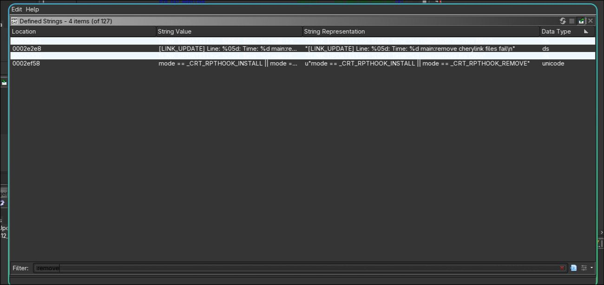

<div align="center">

# R3TR0 | Arrizo 3 Research

**Ingeniería inversa de un sistema multimedia automotriz: Chery Arrizo 3, CheryLink y Windows CE.**

**Español** · [English](README.en.md)

   

*Análisis estático · firmware embebido · Ghidra · metodología reproducible · sin modificaciones al vehículo*

</div>

## Acerca del proyecto

**Arrizo 3 Research** es mi proyecto de aprendizaje e investigación sobre la pantalla multimedia original de un **Chery Arrizo 3 2021**. La meta es identificar su arquitectura y comprender los mecanismos de actualización antes de evaluar cualquier extracción o modificación del firmware.

**Estado: investigación en curso.** Ya hemos identificado la versión visible de la radio y analizado estáticamente una **actualización de CheryLink publicada para Tiggo 2**, utilizada únicamente como muestra comparativa. **No se ha identificado el sistema operativo de mi Arrizo 3, extraído su firmware ni descubierto una vulnerabilidad.**

## Componentes y herramientas

| Elemento | Uso en la investigación |
|---|---|
| Chery Arrizo 3 (2021) | Unidad multimedia original bajo estudio; sin modificaciones |
| Paquete CheryLink para Tiggo 2 | Muestra de referencia, **no** firmware verificado para Arrizo 3 |
| Arch Linux | Entorno de análisis |
| Ghidra | Ingeniería inversa de ejecutables Windows CE ARMv4T |
| `file`, `7z`, `strings`, `sha256sum` | Clasificación, listado y trazabilidad de muestras |
| JADX / ADB | Investigación de la aplicación Android QDrive, del lado del teléfono |
| Python | Scripts originales de triage estático y revisión previa a publicar |
| Cardputer con Bit Pirate | Herramienta disponible para posibles pruebas futuras en banco aislado; **no conectada al vehículo** |

## Resultados iniciales

| Evidencia | Resultado | Alcance |
|---|---|---|
| Versión multimedia visible | `ARRIZO 3_02_31.01_170919_R` | Confirmada por fotografía del Arrizo 3 |
| `CheryLink_Update.exe` | PE32, Windows CE 6.00, ARMv4T | **Tiggo 2**, no prueba el SO del Arrizo 3 |
| `CheryLink.7z` | 1.515 archivos y 20 carpetas | Paquete de referencia |
| Aplicaciones complementarias | Ejecutables PE, APK y ELF ARM | Paquete de referencia |
| `FUN_00011008` | Recorrido recursivo y limpieza de archivos con excepciones | [Hallazgo RE-001](reports/RE-001-cherylink-cleanup.md) |

En el primer hallazgo RE-001 estudié una rutina que recorre directorios, evita las entradas `.` y `..`, omite `EMMC_Check_File.txt` y contempla una excepción para `ceusbkwrapperdrv.dll`. **Es un análisis de funcionamiento, no un exploit.**

## Evidencia visual



*Figura 1. Cadenas localizadas en el actualizador CheryLink del paquete de referencia Tiggo 2. No es firmware extraído del Arrizo 3.*

Las demás capturas se añadirán después de revisar su legibilidad y privacidad.

## Estructura del repositorio

```text
docs/                # Observaciones, metodología, referencias y roadmap
├── INSTALACION.md   # Preparar el laboratorio (español)
├── SETUP.md         # Lab setup (English)
reports/             # RE-001 y futuros informes técnicos
scripts/             # Herramientas Python propias (solo lectura)
tests/               # Pruebas de los scripts
evidence/            # Política de capturas públicas
README.md            # Español — principal
README.es.md         # Entrada alternativa en español
README.en.md         # English — secondary
SECURITY.md          # Límites y divulgación responsable
REVIEW_BEFORE_ANALYSIS.md
```

## Preparación y reproducción

Lee [Preparación del laboratorio (español)](docs/INSTALACION.md) **antes de analizar una muestra**. Se trabaja con copias locales, no con la pantalla instalada en el automóvil.

```bash
git clone https://github.com/Ray1172004/arrizo3-research.git
cd arrizo3-research
python -m unittest discover -s tests -v
python scripts/pre_publish_check.py
```

La inspección de archivos externos se realiza por separado, en directorios privados. No distribuyo el firmware, el actualizador ni las APK propietarias.

## Créditos

Investigación realizada en Arch Linux por [@Ray1172004](https://github.com/Ray1172004). [LinkedIn](https://www.linkedin.com/in/matheo-camacho/) · [Licencia del código propio](LICENSE) · [Seguridad](SECURITY.md).

Los nombres comerciales y el software de terceros pertenecen a sus respectivos titulares. Este repositorio solo publica documentación y herramientas originales, no binarios de Chery.
